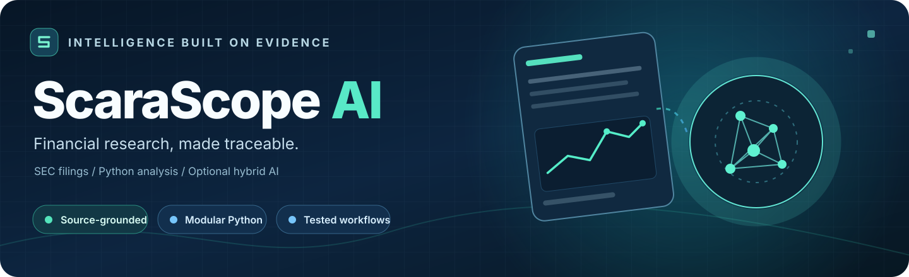
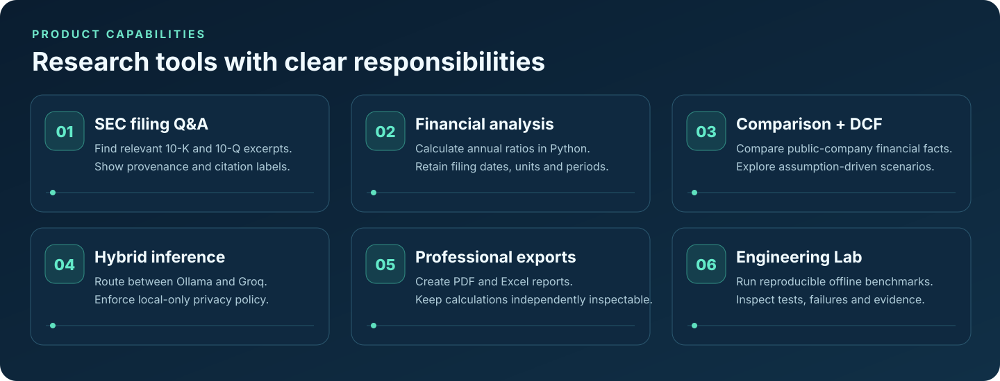
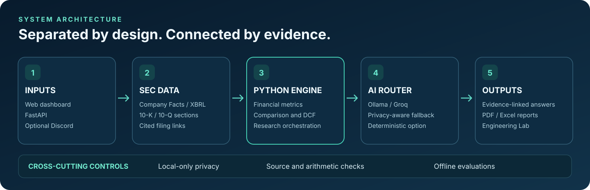

# ScaraScope AI

<p align="center">
  
</p>

<p align="center">
  <a href="https://github.com/Kittybri/ScaraScope-AI/actions/workflows/ci.yml"></a>
  
  
  
  
</p>

<p align="center">
  <strong>Evidence first. Language second.</strong><br/>
  A modular Python financial-research assistant that combines public SEC financial data,
  reproducible calculations, evidence-linked filing questions, and optional local/cloud AI.
</p>

<p align="center">
  <a href="#what-it-does">Explore features</a> ·
  <a href="#quick-start">Run the demo</a> ·
  <a href="#engineering-evidence">Engineering evidence</a> ·
  <a href="#architecture">Architecture</a> ·
  <a href="docs/ENGINEERING_CASE_STUDY.md">Case study</a>
</p>

> **Project status: v0.9 prototype.** Public-company financial analysis and best-effort filing-text Q&A are implemented, but this is not a trading platform, investment adviser, or production-grade financial-data service. Figures in `DEMO` are fictional. Groq and Oracle Cloud are not configured in the repository.

## What it does

<p align="center">
  
</p>

| Research capability | Current implementation |
| --- | --- |
| **SEC financial intelligence** | Retrieve annual US-GAAP XBRL Company Facts for supported U.S. public companies; preserve available filing provenance and reporting periods. |
| **Ask a filing** | Search extracted 10-K and 10-Q sections using **lexical retrieval**; return evidence labels and original filing links, with optional LLM synthesis. |
| **Financial analysis** | Calculate revenue growth and profit margins in Python, not in an LLM. |
| **Comparisons and valuation** | Side-by-side fundamentals and an **illustrative DCF** based on *user-supplied* assumptions, not stock-price predictions. |
| **Hybrid AI** | Configurable Groq and Ollama providers, rule-based selection, graceful fallback, and a `local_only` policy that blocks cloud fallback. |
| **Research outputs** | Bounded research workflows, source-aware PDF/Excel exports, and a manually checked filing watchlist. |
| **Engineering Lab** | Offline benchmarks, automated tests, failure simulations, recorded results, and a dedicated inspection dashboard. |

**Important boundaries:** Filing extraction can miss sections, evidence references are not guaranteed exact paragraph deep links, and citation-label checks do not prove the semantic truth of arbitrary AI answers. Embedding-based RAG and live LLM quality benchmarks are future work.

## New in v0.5: measured financial evidence retrieval

ScaraScope now includes an offline, SEC-source-linked **question-held-out retrieval benchmark**: 17 development questions and 14 frozen question-level held-out questions (12 answerable and 2 unanswerable). On the initial held-out run, BM25 achieved **Recall@3 of 100% versus 66.7% for the existing lexical baseline**; both methods abstained correctly on only **1 of 2** unanswerable questions. The final question set was frozen after the ranking approach was developed, not independently audited. These numbers describe an intentionally small **reconstructed financial-reference corpus**, not raw SEC filing passages, model answer accuracy, or independent issuer-level generalization. The misses and denominators remain visible in the [Engineering Lab](http://127.0.0.1:8000/engineering).

- Optional **BM25** evidence ranking in *Ask a filing*; lexical remains the default.
- Sentence-level **numerical claim checks** against the *specific cited passage*, with conservative extractive fallback.
- Reproducible comparison JSON, frozen gold metadata, regression gates, JUnit CI artifacts, and a separate **CodeQL security-analysis workflow**.
- See [v0.5 methodology and caveats](docs/QA_BENCHMARKS.md) and the [six-minute interview demo](docs/DEMO.md).

## New in v0.6: opt-in semantic retrieval, provenance, and operational evidence

- **Local semantic and hybrid search:** opt-in, preinstalled sentence-transformers embeddings and BM25+semantic rank fusion. Lexical/BM25 remain the default, and missing models cause an explicit error instead of a hidden download. **Real embedding-quality improvements have not yet been measured.**
- **Per-request document provenance:** run IDs, evidence passage hashes, accession identifiers, privacy policy, model and timing metadata without storing prompts or API keys.
- **Additional adversarial and reliability tests**, including untrusted-source instruction screening, invalid embedding results, privacy checks and a safe, bounded localhost API performance probe.
- **Dependency-audit and CycloneDX SBOM workflow** in addition to existing CI and CodeQL security checks.
- See [Local Embeddings](docs/LOCAL_EMBEDDINGS.md), [Threat Model](docs/THREAT_MODEL.md), [Operations](docs/OPERATIONS.md), and [Remaining Roadmap](docs/ROADMAP.md).

These changes are one verified development wave, **not** a finished full-filing QA corpus, proven hallucination elimination, real provider performance comparison or production deployment.

## New in v0.7: real SEC corpus validation tools

The new **operator-run real-filing evaluation pipeline** downloads latest SEC 10-K/10-Q sections when a real SEC contact identifier and network are provided, saves accession-pinned and SHA-256-checked extracted text snapshots locally, and generates **unreviewed** question drafts for independent review. The evaluation supports issuer-disjoint held-out splits, refuses mismatched SEC evidence, and deliberately reports `not_evaluated` until reviewed questions include both answerable and unanswerable cases.

The Engineering Lab now displays real-corpus readiness separately from existing reconstructed-source benchmark numbers. An opt-in live Ollama/Groq probe measures latency and failures, but never invents usage costs or financial answer accuracy.

**Evidence still missing:** actual multi-company filing downloads in the owner's environment, independently reviewed QA gold labels, live Ollama/Groq performance and independently measured financial-answer accuracy. None of those have been claimed as completed.

- [Real SEC corpus and review guide](docs/REAL_SEC_CORPUS.md)
- [Opt-in live-provider smoke test](docs/LIVE_PROVIDER_PROBE.md)
- [Review-gated evaluation architecture decision](docs/adr/0002-snapshots-and-review-gated-metrics.md)

## New in v0.8: defensible SEC evidence review

The **real-filing benchmark** now distinguishes a single reviewed label from an independently second-reviewed one. A metadata-only audit identifies missing rationales; an opt-in strict scoring mode excludes labels without a second reviewer. The CLI compares pinned benchmark runs only when SEC snapshot hashes, evaluation questions, held-out split, review policy, method set and denominators match. If any comparable retrieval metric declines, a regression gate can fail. The Engineering Lab displays real-filing evaluation results **only when eligible reviewed source data actually exists**, otherwise `not_evaluated`.

Document Q&A adds a conservative syntax-level check of explicit `# ScaraScope AI

<p align="center">
  
</p>

<p align="center">
  <a href="https://github.com/Kittybri/ScaraScope-AI/actions/workflows/ci.yml"></a>
  
  
  
  
</p>

<p align="center">
  <strong>Evidence first. Language second.</strong><br/>
  A modular Python financial-research assistant that combines public SEC financial data,
  reproducible calculations, evidence-linked filing questions, and optional local/cloud AI.
</p>

<p align="center">
  <a href="#what-it-does">Explore features</a> ·
  <a href="#quick-start">Run the demo</a> ·
  <a href="#engineering-evidence">Engineering evidence</a> ·
  <a href="#architecture">Architecture</a> ·
  <a href="docs/ENGINEERING_CASE_STUDY.md">Case study</a>
</p>

> **Project status: v0.8 prototype.** Public-company financial analysis and best-effort filing-text Q&A are implemented, but this is not a trading platform, investment adviser, or production-grade financial-data service. Figures in `DEMO` are fictional. Groq and Oracle Cloud are not configured in the repository.

## What it does

<p align="center">
  
</p>

| Research capability | Current implementation |
| --- | --- |
| **SEC financial intelligence** | Retrieve annual US-GAAP XBRL Company Facts for supported U.S. public companies; preserve available filing provenance and reporting periods. |
| **Ask a filing** | Search extracted 10-K and 10-Q sections using **lexical retrieval**; return evidence labels and original filing links, with optional LLM synthesis. |
| **Financial analysis** | Calculate revenue growth and profit margins in Python, not in an LLM. |
| **Comparisons and valuation** | Side-by-side fundamentals and an **illustrative DCF** based on *user-supplied* assumptions, not stock-price predictions. |
| **Hybrid AI** | Configurable Groq and Ollama providers, rule-based selection, graceful fallback, and a `local_only` policy that blocks cloud fallback. |
| **Research outputs** | Bounded research workflows, source-aware PDF/Excel exports, and a manually checked filing watchlist. |
| **Engineering Lab** | Offline benchmarks, automated tests, failure simulations, recorded results, and a dedicated inspection dashboard. |

**Important boundaries:** Filing extraction can miss sections, evidence references are not guaranteed exact paragraph deep links, and citation-label checks do not prove the semantic truth of arbitrary AI answers. Embedding-based RAG and live LLM quality benchmarks are future work.

## New in v0.5: measured financial evidence retrieval

ScaraScope now includes an offline, SEC-source-linked **question-held-out retrieval benchmark**: 17 development questions and 14 frozen question-level held-out questions (12 answerable and 2 unanswerable). On the initial held-out run, BM25 achieved **Recall@3 of 100% versus 66.7% for the existing lexical baseline**; both methods abstained correctly on only **1 of 2** unanswerable questions. The final question set was frozen after the ranking approach was developed, not independently audited. These numbers describe an intentionally small **reconstructed financial-reference corpus**, not raw SEC filing passages, model answer accuracy, or independent issuer-level generalization. The misses and denominators remain visible in the [Engineering Lab](http://127.0.0.1:8000/engineering).

- Optional **BM25** evidence ranking in *Ask a filing*; lexical remains the default.
- Sentence-level **numerical claim checks** against the *specific cited passage*, with conservative extractive fallback.
- Reproducible comparison JSON, frozen gold metadata, regression gates, JUnit CI artifacts, and a separate **CodeQL security-analysis workflow**.
- See [v0.5 methodology and caveats](docs/QA_BENCHMARKS.md) and the [six-minute interview demo](docs/DEMO.md).

## New in v0.6: opt-in semantic retrieval, provenance, and operational evidence

- **Local semantic and hybrid search:** opt-in, preinstalled sentence-transformers embeddings and BM25+semantic rank fusion. Lexical/BM25 remain the default, and missing models cause an explicit error instead of a hidden download. **Real embedding-quality improvements have not yet been measured.**
- **Per-request document provenance:** run IDs, evidence passage hashes, accession identifiers, privacy policy, model and timing metadata without storing prompts or API keys.
- **Additional adversarial and reliability tests**, including untrusted-source instruction screening, invalid embedding results, privacy checks and a safe, bounded localhost API performance probe.
- **Dependency-audit and CycloneDX SBOM workflow** in addition to existing CI and CodeQL security checks.
- See [Local Embeddings](docs/LOCAL_EMBEDDINGS.md), [Threat Model](docs/THREAT_MODEL.md), [Operations](docs/OPERATIONS.md), and [Remaining Roadmap](docs/ROADMAP.md).

These changes are one verified development wave, **not** a finished full-filing QA corpus, proven hallucination elimination, real provider performance comparison or production deployment.

## New in v0.7: real SEC corpus validation tools

The new **operator-run real-filing evaluation pipeline** downloads latest SEC 10-K/10-Q sections when a real SEC contact identifier and network are provided, saves accession-pinned and SHA-256-checked extracted text snapshots locally, and generates **unreviewed** question drafts for independent review. The evaluation supports issuer-disjoint held-out splits, refuses mismatched SEC evidence, and deliberately reports `not_evaluated` until reviewed questions include both answerable and unanswerable cases.

The Engineering Lab now displays real-corpus readiness separately from existing reconstructed-source benchmark numbers. An opt-in live Ollama/Groq probe measures latency and failures, but never invents usage costs or financial answer accuracy.

**Evidence still missing:** actual multi-company filing downloads in the owner's environment, independently reviewed QA gold labels, live Ollama/Groq performance and independently measured financial-answer accuracy. None of those have been claimed as completed.

- [Real SEC corpus and review guide](docs/REAL_SEC_CORPUS.md)
- [Opt-in live-provider smoke test](docs/LIVE_PROVIDER_PROBE.md)
- [Review-gated evaluation architecture decision](docs/adr/0002-snapshots-and-review-gated-metrics.md)

 and `%` claims against the passage they cite. Citation and number checks cannot establish semantic truth, and reviewer aliases do not prove independent human review.

**Still unmeasured:** independent real SEC human-validated answer accuracy, full SEC corpus generalization, actual local semantic ranking performance, and live Groq/Ollama cost and latency. The operator must still download filings and review gold labels; no sources or accuracy results were fabricated.

See [Independent Review and Regression Protocol](docs/REVIEW_PROTOCOL.md), [Real SEC Corpus Guide](docs/REAL_SEC_CORPUS.md) and [Engineering Lab](http://127.0.0.1:8000/engineering).

## New in v0.9: explainable claim audits and sanitized tracing

ScaraScope document Q&A now includes a **structured claim audit**. It rejects clear unknown-citation, unsupported number/unit, explicit fiscal-year and uncited substantive-claim mistakes, then falls back to source excerpts. A syntactically accepted model answer is still labeled `needs_semantic_review`, **not** fact-checked: the system cannot guarantee qualitative meaning, causality or valid financial denominators.

Normal API responses include an `X-Request-ID` correlated with document evidence provenance. The Engineering Lab shows **real local HTTP request p50/p95 latency, error counts and recent run IDs** using a bounded, process-local buffer without storing prompts, keys, IP addresses or query strings. This is not measured Groq/Ollama latency or hosted service uptime.

Additional tests exercise Unicode-obfuscated instruction injection, unsupported citations and years, and large declared request bodies. A 64 KiB Content-Length gate is only a secondary safeguard; secure public deployment still needs a real reverse-proxy body limit and network controls.

See [Operations and Trace Limits](docs/OPERATIONS.md), [Threat Model](docs/THREAT_MODEL.md) and [Engineering Roadmap](docs/ROADMAP.md). The offline regression tests do **not** establish live SEC answer accuracy or semantic verification.

## Quick start

Run a **fully offline fictional demo**, with no API keys or Oracle account required.

```bash
git clone https://github.com/Kittybri/ScaraScope-AI.git
cd ScaraScope-AI

python3 -m venv .venv
source .venv/bin/activate       # Windows: .venv\Scripts\activate
pip install -e '.[test]'

cp .env.example .env            # Windows: copy .env.example .env
uvicorn scarascope.api:app --reload --host 127.0.0.1 --port 8000
```

| Open locally | Try this |
| --- | --- |
| **[Research dashboard](http://127.0.0.1:8000)** | Enter `DEMO` and run financial analysis, company research, or *Ask a filing*. |
| **[Engineering Lab](http://127.0.0.1:8000/engineering)** | Run the offline benchmark and inspect the cases. |
| **[API reference](http://127.0.0.1:8000/docs)** | Explore FastAPI endpoints and typed request/response models. |

Those localhost links work **after the server starts**. To query a real ticker such as `MSFT`, set `SEC_USER_AGENT` in your untracked `.env` to an application identifier containing your real contact email. No SEC API key is needed for public EDGAR data.

## Engineering evidence

ScaraScope is built as an inspectable software project, not a feature-count competition.

| Independently scoped check | Last verified offline result |
| --- | ---: |
| Historical financial checks using fixed SEC-source-linked references | **34 / 34** |
| Deterministic arithmetic checks | **6 / 6** |
| Synthetic lexical-retrieval checks | **5 / 5** |
| Simulated provider reliability and privacy checks | **6 / 6** |
| Full automated Python test suite | **124 passing tests** |

These are **offline regression/fixture results** from the v0.4 development run, **not real-world LLM answer-accuracy scores**. The fixed financial reference cases use historical Apple FY2023 and Microsoft FY2024 filing values. To reproduce the benchmark:

```bash
python -m pytest -q
python -m scarascope.evaluation.runner --fail-on-regression
```

The CI workflow runs the tests and saves a benchmark JSON artifact. See the [verified v0.4 run](https://github.com/Kittybri/ScaraScope-AI/actions/runs/38070810895), [benchmark methodology](docs/BENCHMARKS.md), and [engineering case study](docs/ENGINEERING_CASE_STUDY.md). Benchmarks are kept separate by category so a passing arithmetic test cannot masquerade as proof of LLM reasoning quality.

## Architecture

<p align="center">
  
</p>

The core is **headless and modular**. Discord and the web dashboard are interfaces, not the research engine.

```text
scarascope/
├── api/                HTTP endpoints and authentication
├── adapters/discord/   Optional Discord client
├── ai/
│   ├── providers/      Ollama and Groq adapters
│   ├── retrieval/      Document ranking and evidence labels
│   └── agents/         Bounded plans and verification steps
├── data/sec/           EDGAR access, XBRL, filing sections
├── finance/            Ratios, peer comparisons, DCF
├── services/           Research and document Q&A workflows
├── reports/            PDF and Excel generators
├── evaluation/         Datasets, test runners, result records
├── verification/       Source, date, unit, claim checks
├── observability/      Provider events and diagnostics
├── storage/            Metadata and watchlist persistence
└── static/             Web dashboard and Engineering Lab
```

Full design constraints are documented in [ARCHITECTURE.md](docs/ARCHITECTURE.md). ScaraScope is **independent of the author's personal Scaramouche and Wanderer projects**.

## Optional integrations

<details>
<summary><strong>Use real SEC data</strong></summary>

Set `SEC_USER_AGENT` in `.env` with a real contact email, restart, and enter a supported U.S. stock ticker. Retrieval is subject to SEC fair-access limits, source formatting, and XBRL taxonomy coverage.

</details>

<details>
<summary><strong>Enable Groq for cloud-eligible research</strong></summary>

```dotenv
GROQ_API_KEY=your-key-here
GROQ_MODEL=openai/gpt-oss-20b
```

Verify your model availability before use. Never commit your real `.env` file.

</details>

<details>
<summary><strong>Enable local Ollama inference</strong></summary>

Install Ollama and pull an appropriate model, then configure:

```dotenv
OLLAMA_ENABLED=true
OLLAMA_BASE_URL=http://127.0.0.1:11434
OLLAMA_MODEL=llama3.2:3b
```

When the backend runs on Oracle, `127.0.0.1` refers to the cloud VM, **not your laptop**. Use an authenticated private connection; never expose the Ollama port publicly. `local_only` disables cloud fallback by policy.

</details>

<details>
<summary><strong>Use the optional Discord interface</strong></summary>

```bash
pip install -e '.[discord]'
python -m scarascope.discord_bot
```

Configure `DISCORD_BOT_TOKEN` and run FastAPI separately. Discord remains a thin API client.

</details>

## Documentation and development

| Guide | Purpose |
| --- | --- |
| [Features](docs/FEATURES.md) | Implemented functionality and boundaries |
| [Architecture](docs/ARCHITECTURE.md) | Responsibility boundaries and extension points |
| [Evaluation](docs/EVALUATION.md) | Test methodology and limitations |
| [Benchmarks](docs/BENCHMARKS.md) | Historical reference dataset and reproducibility |
| [Security](docs/SECURITY.md) | Privacy, authentication, rate limits, safe deployment |
| [Engineering case study](docs/ENGINEERING_CASE_STUDY.md) | Engineering decisions and tradeoffs |

**Development roadmap:** robust filing parsing and stronger claim verification; real-world held-out financial QA benchmarks; semantic retrieval if it improves measured quality; secure Oracle deployment and measured Ollama/Groq performance.

> **Deployment caution:** Set `SCARASCOPE_API_KEY` and `SCARASCOPE_REQUIRE_AUTH=true` before any public deployment; use HTTPS, network controls, and appropriate per-user quotas. The existing prototype does not implement full multi-user isolation. Research is informational only and requires source review for consequential decisions.

<sub>README illustrations are conceptual SVG graphics made for this repository, not screenshots or live performance measurements. No software license has been granted in this repository.</sub>
